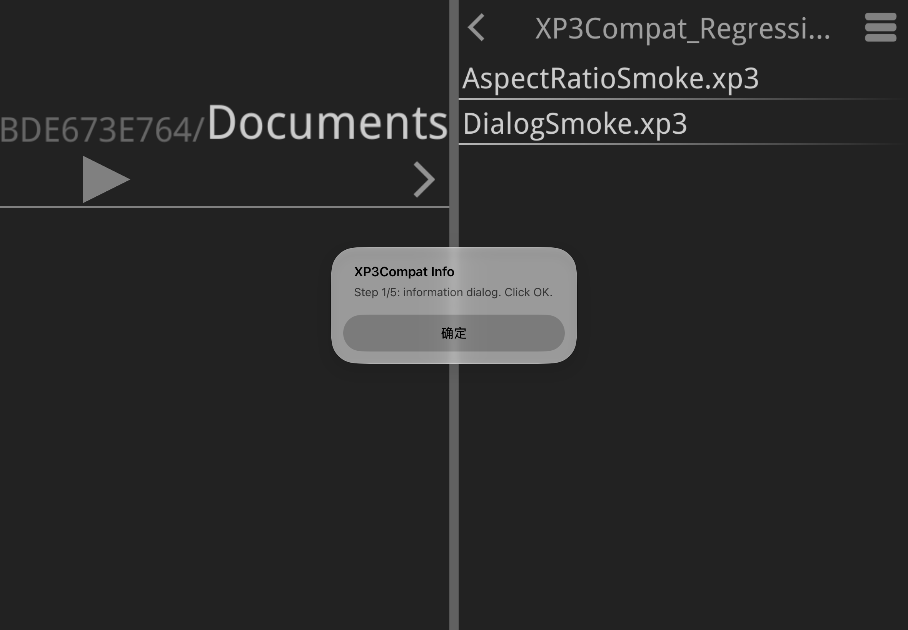
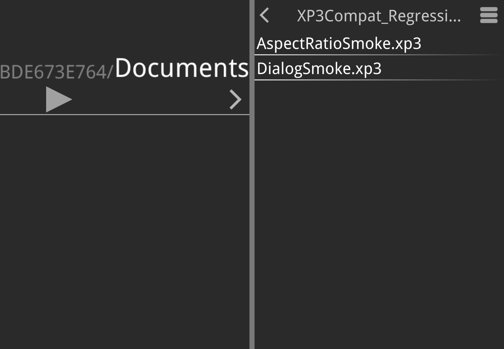
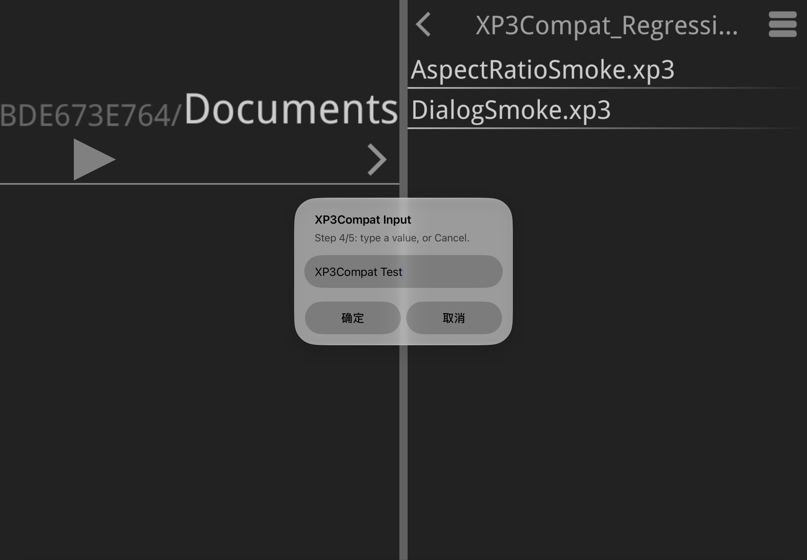

# XP3Compat

修复 iOS 上 XP3Player（krkr / krkr2 / Kirikiroid / Kirikiroid2）1.3.11 的系统弹窗问题。

这款模拟器多年没有更新，在较新的 iOS 上，新建文件夹、确认删除、显示游戏消息、输入文字这几类操作会直接闪退。XP3Compat 是一个注入到应用里的动态库，接管这些弹窗，让按钮选择和输入内容能正确返回给应用。

支持 iPhone 和 iPad，重新签名后即可安装，无需越狱。Apple Silicon Mac 可以通过 PlayCover 运行。处理后的应用名为 **XP3Player Fix**，Bundle ID 与原版不同，可以和原版同时安装。



## 修复内容

- **iPad 全屏显示**：修复文件管理界面的显示区域限制，适配不同尺寸的 iPad 屏幕。
- **新建文件夹**：在目录管理里可以正常创建。
- **删除确认**：确认弹窗正常显示，所选结果会正确传回应用。
- **游戏消息（Info / Warning）**：游戏弹出的提示和警告正常显示，点击确认后关闭。
- **按钮选择**：多个按钮的弹窗返回正确的选项，游戏按所选分支继续。
- **文字输入**：调出系统输入框时不再闪退，输入的内容会传回游戏。
- **Mac（PlayCover）**：原生弹窗可以接收普通鼠标事件，点按钮和输入文字都能正常使用。

## 安装

整体流程：准备环境、获取源码、构建、注入 IPA、生成共存包、按平台签名安装、复制游戏数据。

### 1. 准备环境

- 一台 Mac，用于构建插件、处理 IPA，以及为 PlayCover 签名。
- Xcode，或带有 iPhoneOS SDK 的开发工具。安装完整的 Xcode 最省事，`build.sh` 会自动选择可用的 SDK。
- Python 3 和 Git。
- 你自己的 XP3Player 1.3.11（build 15）IPA，需要是已解密、可以直接处理的版本。
- iPhone / iPad：一个 IPA 重签工具，以及对应的签名方式（证书或开发者账号）。
- Mac：安装 PlayCover。签名使用系统自带的 `codesign`，见第 6 步。

### 2. 获取源码

```bash
git clone https://github.com/rwx9032/KrKr2_iOS_fix.git
cd KrKr2_iOS_fix
```

### 3. 构建

```bash
bash build.sh
```

构建完成后得到 `XP3Compat.dylib`，即下一步要注入的修复库。默认构建主线的正式版本。

### 4. 注入

```bash
python3 tools/inject_ipa.py "/path/to/XP3Player.ipa" XP3Compat.dylib /tmp/XP3Player-injected.ipa
```

- 把 `/path/to/XP3Player.ipa` 换成你自己的 IPA 路径，路径里有空格时保留双引号。
- 输出文件名必须是尚未存在的新名字，脚本不会覆盖同名文件。重复执行时换一个名字（例如 `XP3Player-injected-2.ipa`），后续命令的输入路径也要对应修改。
- 这一步只做注入，共存身份在下一步设置。

### 5. 生成共存包

```bash
python3 tools/clone_ipa.py /tmp/XP3Player-injected.ipa /tmp/XP3Player-Fix.ipa
```

输出文件同样使用未占用的新名字。这一步把应用改成独立身份：显示名 XP3Player Fix，Bundle ID `tvp.XP3Player.Compat`，产出 `/tmp/XP3Player-Fix.ipa`。该包尚未签名，需要在第 6 步签名后安装。

### 6. 签名并安装

#### iPhone / iPad

用你的签名工具导入 `/tmp/XP3Player-Fix.ipa`，按工具的正常流程配置证书并签名。

签名时，**主应用和内嵌的 `Frameworks/XP3Compat.dylib` 要一起重签**，漏掉内嵌库会导致应用启动失败。

签好后正常安装。如果系统提示应用未受信任，按提示在设置里信任你的证书。完成后桌面上会出现 XP3Player Fix 的图标。

#### Mac（PlayCover）

先给插件和应用完整签名，再把重新打包的 IPA 导入 PlayCover。在终端执行：

```bash
XP3_STAGE="$(mktemp -d /tmp/xp3-playcover.XXXXXX)"
ditto -xk /tmp/XP3Player-Fix.ipa "$XP3_STAGE"
chmod +x "$XP3_STAGE/Payload/XP3Player.app/XP3Player"
codesign --force --sign - "$XP3_STAGE/Payload/XP3Player.app/Frameworks/XP3Compat.dylib"
codesign --force --sign - "$XP3_STAGE/Payload/XP3Player.app"
codesign --verify --deep --strict "$XP3_STAGE/Payload/XP3Player.app"
(cd "$XP3_STAGE" && ditto -c -k --keepParent Payload /tmp/XP3Player-Fix-PlayCover.ipa)
```

这几条命令依次完成：创建临时目录、解开 IPA、恢复主程序的可执行权限、先对内嵌的 `XP3Compat.dylib` 做 ad-hoc 签名、再对整个 `.app` 签名、校验签名、重新压缩成 `/tmp/XP3Player-Fix-PlayCover.ipa`。导入 PlayCover 的是最后生成的这个文件。

如果 PlayCover 报 `code object is not signed at all`，检查两条 `codesign --force --sign -` 命令以及最后的打包步骤。

### 7. 打开应用

在桌面找到 XP3Player Fix 并打开。它使用独立的数据目录，游戏和存档需要重新导入，见下一节。

## 迁移数据

XP3Player Fix 和原版各有各的数据目录。请用当初向原版导入游戏的方式（比如文件共享，或应用内的 Web 文件服务器），把游戏封包和存档导入到 XP3Player Fix，之后两个应用各用各的目录。

| | 原版 | 共存包 |
|---|---|---|
| 桌面显示名 | XP3Player | XP3Player Fix |
| Bundle ID | `tvp.XP3Player` | `tvp.XP3Player.Compat` |

## 仓库与分支

仓库提供插件源码、打包工具和测试脚本。XP3Player 的 IPA 需要自行准备（1.3.11，build 15，arm64，已解密）。

- **main**：主线，即 0.3 路线。保持原版的显示和启动行为，只修复上面列出的系统交互问题。`bash build.sh` 默认构建的就是它。
- **[experimental/iphone-duo](https://github.com/rwx9032/KrKr2_iOS_fix/tree/experimental/iphone-duo)**：iPhone Duo 的显示适配实验。模拟器里的展开与折叠、游戏画面比例、点击和弹窗输入已经能正常工作，适配仍在进行，尚未合并进主线。

## 常见问题

**需要越狱吗？**
不需要。整个过程是处理 IPA 副本、用自己的证书重签、正常安装，和侧载其他应用一样。

**会影响原版 XP3Player 吗？**
不会。Fix 版是 Bundle ID 不同的独立应用，可以和原版并排安装。

**装好后游戏和存档不见了？**
Fix 版的数据目录是独立的，参考“迁移数据”一节重新导入。

**仓库里有现成的 IPA 或 dylib 吗？**
没有，请自行准备 IPA 并按上面的步骤构建。

**全屏、旋转这些显示问题解决了吗？**
显示适配在 `experimental/iphone-duo` 分支进行，目前已有模拟器上的测试进展。

**PlayCover 提示应用未签名？**
确认导入的是最终生成的 `/tmp/XP3Player-Fix-PlayCover.ipa`。如果报 `code object is not signed at all`，回到第 6 步的 Mac 部分，逐条检查签名命令和打包命令。

## 测试情况

- Mac PlayCover：在真实环境中测试过消息弹窗、输入弹窗，以及目录的创建和删除。
- iPhone / iPad 模拟器：系统弹窗相关用例通过。
- 自制的 640×480 比例点击测试夹具：通过。
- iPadOS 真机：文件夹操作和游戏弹窗测试通过；实体 iPhone 尚未测试。

## 运行截图

截图来自 iPadOS 模拟器。

**文件管理**



**文字输入弹窗**



## 相关文档

- [技术说明](docs/TECHNICAL.zh-CN.md)：修复原理、构建选项和测试命令。
- [experimental/iphone-duo 分支](https://github.com/rwx9032/KrKr2_iOS_fix/tree/experimental/iphone-duo)：iPhone Duo 显示实验。
